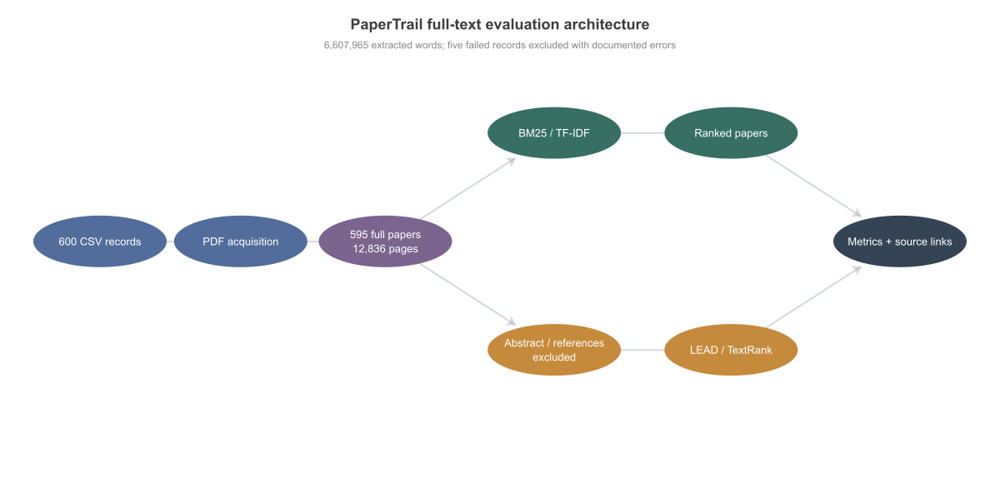
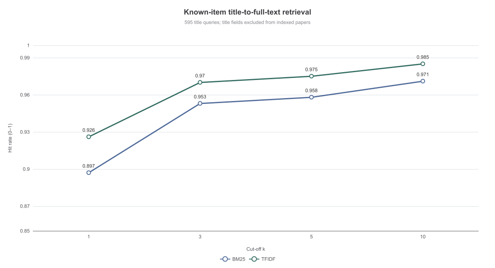
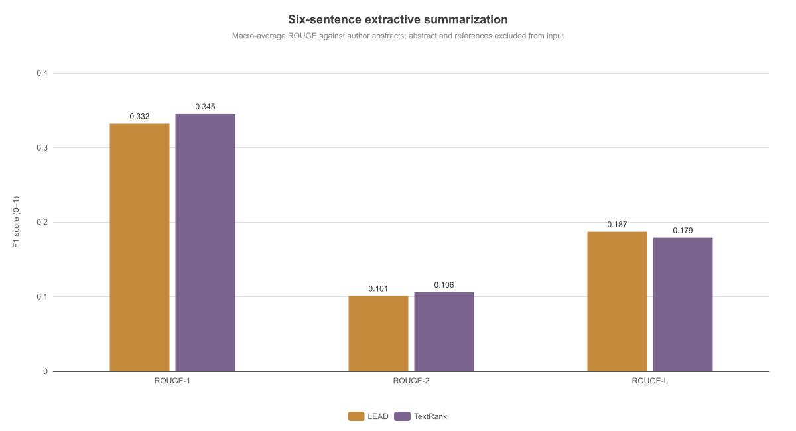

# PaperTrail: Full-Text Discovery and Summarization of 595 AI Research Papers

## Abstract

Research students face a growing volume of scientific literature and need tools that help them locate papers and inspect their central claims without losing contact with the sources. This report presents **PaperTrail**, an offline-first natural-language-processing prototype for full-text research discovery, extractive summarization, evidence inspection, and document-grounded question answering. The evaluation upgrades an earlier abstract-only study by acquiring and extracting the complete PDFs linked from a supplied dataset. Of 600 requested arXiv records, **595 full papers** were processed successfully, comprising **12,836 pages and 6,607,965 extracted words**. Four unavailable PDF downloads and one parser-limit failure were excluded after the user accepted this final corpus. Known-item retrieval used every title as a query against all extracted papers. TF-IDF achieved mean reciprocal rank (MRR) **0.949** and Hit@10 **0.985**, compared with **0.926** and **0.971** for BM25. A paired bootstrap favored TF-IDF on this corpus. For summarization, six-sentence LEAD and TextRank outputs were compared with author abstracts after conservatively removing abstracts and references from the input. TextRank obtained macro ROUGE-1/2/L scores of **0.345/0.106/0.179**, while LEAD obtained **0.332/0.101/0.187**. These results demonstrate effective lexical navigation and measurable abstract alignment, but not natural-question relevance, abstractive summary quality, or factual QA accuracy. PDF extraction quality, title leakage, corpus provenance, and reference-based ROUGE limitations are examined explicitly.

## 1. Problem Definition, NLP Justification, and Value

The target problem is **research discovery and triage under information overload**. A student beginning a literature review may possess a title, topic, or methodological phrase but still need to locate the correct document, understand its argument, and decide whether full reading is worthwhile. A spreadsheet records bibliographic metadata but cannot rank documents by textual relevance or construct a short brief. Conversely, an unconstrained generative assistant may produce fluent prose without showing which document supports each statement. PaperTrail addresses this gap by combining corpus-conditioned retrieval, extractive summarization, and source-linked inspection.

NLP is appropriate because the central objects and operations are linguistic. Normalization and tokenization make matching consistent; TF-IDF and BM25 estimate lexical relevance; sentence segmentation and graph ranking support summarization; and optional neural embeddings provide a route to semantic matching. These components address separable failure modes. Retrieval selects candidate papers, summarization reduces reading effort, and citations allow a user to inspect evidence. The value proposition is therefore faster, more transparent navigation—not automatic judgment of scientific quality.

The expected output is a ranked paper list with titles, dates, links, summaries, and inspectable source text. The existing web application additionally processes an uploaded PDF into page-aware chunks, produces a structured research brief, and answers questions through evidence quotation or an optional external evidence-only LLM. The measured full-text experiment evaluates retrieval and summarization; it does not claim measured cross-paper QA accuracy. No controlled user study was performed, so no time-saving percentage is claimed. Intended users remain responsible for reading original papers before citing results or making high-stakes decisions.

## 2. Dataset Acquisition and Corpus Audit

### 2.1 Supplied records and full-text upgrade

The starting dataset is `data/ai_research_papers.csv`, containing 600 rows and five fields: `Title`, `Authors`, `Published`, `Summary`, and `Link`. Every link identifies an arXiv abstract page. The file has no missing cells, exact duplicate rows, duplicate normalized titles, or duplicate links. Its SHA-256 hash is `feb8262a4512b5677797d16c4ca65435d19ea0d2d286bfe9defc475c820863f8`. Publication dates range from 21 November 2008 to 10 April 2025, with 70.5% of records dated 2023–2025. The collection procedure is undocumented, so this is a convenience corpus rather than a representative sample of AI research.

The upgrade retrieves each linked PDF, saves it locally, extracts selectable text page by page, and records extraction metadata. Stable identifiers follow CSV order, such as `paper-0001`. Processing is resumable: completed files are not downloaded again, and failures retain their stage and error. A bounded parallel downloader uses four workers with global request pacing to avoid an uncontrolled burst of requests. PDFs and extracted text are excluded from Git because of their size and redistribution uncertainty; the CSV, code, profiles, and metrics remain reproducible artifacts.

The user accepted the final **595-paper corpus** rather than continuing retries. Four records returned HTTP 404 at download: `paper-0313` (`2001.05375v1`), `paper-0383` (`2411.10463v3`), `paper-0541` (`2304.07999v2`), and `paper-0597` (`2110.09271v3`). One record, `paper-0518` (`0811.3537v1`), reached the PDF parser’s token-per-stream limit. These exclusions are recorded in `results/full_text/corpus_profile.json`. Thus, all reported full-text results concern 595—not 600—papers.

### 2.2 Scale and extraction quality

The accepted papers contain 12,836 pages. Paper length has a mean of 21.57 pages, median of 16, and maximum of 295. Extracted text totals 6,607,965 whitespace-delimited words, with mean 11,105.82, median 9,243, and maximum 117,807 per paper. These figures describe machine-extracted tokens rather than a linguistically normalized word count; equations, references, and fragmented layout text can inflate them.

| Corpus measure | Value |
|---|---:|
| Requested CSV records | 600 |
| Successfully extracted full papers | 595 |
| Excluded records | 5 |
| Total pages | 12,836 |
| Total extracted words | 6,607,965 |
| Mean / median pages | 21.57 / 16 |
| Mean / median extracted words | 11,105.82 / 9,243 |

Extraction coverage was estimated by checking how many normalized abstract tokens appear in the extracted paper. Mean coverage is 0.977 and median 0.991, indicating that the abstract is usually recoverable. However, minimum coverage is 0.333 and nine papers fall below 0.80. `paper-0155` has coverage 0.333 and only 2,063 extracted words; `paper-0505` has coverage 0.446. Such papers can lose retrieval and summarization evidence even though their PDFs were accepted. Coverage is a diagnostic, not proof of semantic completeness: it does not detect every reading-order, equation, table, or character-decoding error. Scanned-image papers would require OCR, which this project does not include.

## 3. Preprocessing and System Architecture

PDF extraction preserves a list of page texts and one-based page numbers. Whitespace cleanup collapses embedded line breaks for retrieval without rewriting technical terminology. The full-text index contains one document per paper, including all extracted pages, but does not add a separate metadata title field. This prevents a trivial database-style title match while retaining whatever title text naturally occurs in the PDF. That distinction is important because printed titles on first pages can still make known-item retrieval easier than natural-topic search.

The architecture deliberately uses different document views for retrieval and summarization. Retrieval uses all extracted pages so that evidence anywhere in a paper can contribute. Summarization must not simply copy the reference abstract, so it uses a conservative body-only view. When an explicit `Abstract` to `Introduction` boundary is detected on page one, text from the introduction onward is retained; otherwise the entire first page is dropped. This succeeded for 268 papers and triggered first-page removal for 327. A terminal `References` or `Bibliography` heading is also used to remove the reference section. The fallback can discard useful introduction material, while an unrecognized abstract can remain; both possibilities limit strict causal interpretation of ROUGE differences.



TF-IDF uses English stop-word removal, unigram and bigram features, sublinear term frequency, and normalized vectors. BM25 uses term frequency, inverse document frequency, saturation, and document-length normalization with `k1 = 1.5` and `b = 0.75`. These sparse representations require no training and run locally. Sentence-BERT embeddings and reciprocal-rank fusion are implemented options in the broader prototype but were not evaluated on the 595-paper corpus. Accordingly, the report does not claim dense or hybrid superiority.

For summarization, LEAD selects opening sentences and TextRank ranks sentence vertices by graph centrality using lexical similarity, then restores selected sentences to source order (Mihalcea and Tarau, 2004). Both produce six-sentence extracts. The web application’s chunking, structured fields, evidence quotations, and optional BART/OpenAI integrations remain demonstration capabilities rather than measured components of this experiment.

### 3.1 Tool stack and implementation rationale

The implementation uses Python for document processing and evaluation, pandas for CSV validation, NumPy for numerical aggregation and bootstrap resampling, scikit-learn for TF-IDF, and PyMuPDF for page-level PDF extraction. Streamlit provides the interactive web interface, while ECharts and Sharp generate reproducible report figures from measured JSON rather than manually edited graphics. Standard-library unit tests support offline verification. These tools were selected because they are inspectable, widely used, and sufficient for a local prototype without model training or paid services.

The broader architecture is compatible with Hugging Face sentence transformers and BART, FAISS for approximate dense-vector search, and an optional OpenAI generation route. These integrations are not dependencies of the measured experiment. Keeping them optional reduces installation size and avoids conflating classical baseline results with unmeasured neural components. A LangChain framework was not necessary: the project’s explicit retrieval, summarization, and evidence objects make data flow easier to inspect for this focused task.

Reproducibility is supported at several levels. Input hashing identifies the CSV version; stable paper identifiers connect metadata, PDFs, extracted JSON, ranks, and summaries; progress records distinguish download and extraction failures; and a fixed random seed makes bootstrap intervals repeatable. The result file retains every query’s rank under both methods and every generated summary with its ROUGE scores. This permits aggregate claims to be recomputed and individual outliers to be traced. Local bulk documents are intentionally separated from version-controlled evidence, so another researcher must have network access and permission to obtain the source PDFs before rebuilding the corpus.

Computational design also reflects the corpus scale. One paper-level document avoids creating millions of unnecessarily fine-grained chunks for known-item navigation. Parallel PDF acquisition is bounded, and summary generation uses four workers, whereas evaluation remains reproducible from saved extracted text. This choice does not establish that paper-level retrieval is optimal for answering detailed questions. Passage retrieval would be more appropriate when a user needs a particular equation, dataset, or limitation, and would require a separate relevance-annotation design.

## 4. Experimental Design and Evaluation Metrics

### 4.1 Known-item full-text retrieval

Each cleaned title becomes one query against all 595 extracted full papers, and only the same-row paper is designated relevant. Each method returns at most ten positive-scoring candidates. Target ranks are retained per query; absence from the top ten contributes zero reciprocal rank. Hit@k is the fraction of targets found at rank k or better. With exactly one designated relevant item, Hit@k equals Recall@k for this task. MRR is calculated as

`MRR = (1/N) × Σ 1/rank_i`,

where `N = 595` and misses contribute zero. Hit@1 measures immediate navigation, Hit@10 measures whether a target appears in a short result list, and MRR distinguishes intermediate ranks. Neither metric evaluates how many other papers are relevant to a genuine topic query.

Uncertainty was estimated using 5,000 paper-level bootstrap resamples with seed 2026. Percentile intervals were calculated for MRR and hit rates. A paired bootstrap evaluated TF-IDF-minus-BM25 reciprocal-rank differences on the same sampled papers. These intervals describe variation across this fixed corpus, not uncertainty about a representative population of all scientific papers. Both retrievers used established settings without result-dependent tuning.

This design has an important optimistic bias. Even though separate title metadata was excluded, the title is commonly printed in the extracted first page and may be repeated in headers. High scores therefore demonstrate reliable known-item navigation of extracted documents, not general semantic retrieval. A stronger future study would remove exact title strings and repeated headers, then evaluate independently authored natural questions with multi-relevance judgments.

### 4.2 Reference-based extractive summarization

The summarization task uses author abstracts as references and six-sentence extracts from the abstract-excluded body as predictions. ROUGE-1 measures unigram overlap, ROUGE-2 measures bigram overlap, and ROUGE-L measures longest-common-subsequence overlap. The implementation reports token-level F1 and macro-averages equally over 595 papers; medians are also retained. All generated summaries and per-paper scores are stored for inspection.

ROUGE is appropriate for reproducible lexical comparison but insufficient as a complete measure of summary quality. An author abstract has different rhetorical goals from a body extract, so low overlap can reflect legitimate wording differences rather than error. Conversely, high overlap does not guarantee coverage of methods, results, and limitations. The experiment compares abstract alignment, not factual faithfulness or human usefulness. Independent reference summaries and human ratings would be needed for those claims.

## 5. Results and Error Analysis

### 5.1 Retrieval performance

TF-IDF outperformed BM25 on every reported full-text cut-off. It placed the correct paper first for 92.6% of titles and within ten results for 98.5%, with nine misses. BM25 achieved 89.7% Hit@1 and 97.1% Hit@10, with seventeen misses. The paired MRR difference was 0.0227, and its 95% bootstrap interval [0.0063, 0.0391] excluded zero. This is evidence of an advantage **on this fixed known-item task**, not universal TF-IDF superiority.

| Retriever | MRR [95% CI] | Hit@1 | Hit@3 | Hit@5 | Hit@10 | Top-10 misses |
|---|---|---:|---:|---:|---:|---:|
| BM25 | 0.926 [0.907, 0.944] | 0.897 | 0.953 | 0.958 | 0.971 | 17 |
| TF-IDF | 0.949 [0.933, 0.964] | 0.926 | 0.970 | 0.975 | 0.985 | 9 |



Seven papers were missed by both methods: *Confident AI*, *Towards an AI task tensor*, *Transfeminist AI Governance*, *Human Learning about AI*, *Where Assessment Validation and Responsible AI Meet*, *First Analysis of the EU Artificial Intelligence Act*, and *Governance of the AI, by the AI, and for the AI*. Generic terminology and limited distinctive title words can reduce discrimination. Extraction failure also matters: the second and sixth examples are precisely low-coverage papers. In contrast, BM25 missed *AI Safety for Everyone* while TF-IDF ranked it eighth, and TF-IDF missed *The Ethics of AI in Education* while BM25 ranked it second. Such disagreements motivate future hybrid experiments but do not establish that fusion would resolve them.

### 5.2 Summarization performance

TextRank produced higher mean ROUGE-1 and ROUGE-2, whereas LEAD produced slightly higher ROUGE-L. TextRank’s median ROUGE-1 was 0.355 versus 0.320 for LEAD, suggesting that graph-based selection more often recovered abstract terminology. LEAD’s small ROUGE-L advantage indicates that opening body sentences sometimes preserved longer reference sequences. Neither margin supports a claim of better factual summaries without human assessment.

| Method | ROUGE-1 mean / median | ROUGE-2 mean / median | ROUGE-L mean / median |
|---|---:|---:|---:|
| LEAD | 0.332 / 0.320 | 0.101 / 0.063 | 0.187 / 0.158 |
| TextRank | 0.345 / 0.355 | 0.106 / 0.096 | 0.179 / 0.177 |



Low-score cases reveal both task and extraction difficulties. LEAD ROUGE-1 was 0.024 for *How Generative AI supports human in conceptual design* and 0.043 for the low-coverage *Towards an AI task tensor*. TextRank scored 0.009 for *Trustworthy AI: From Principles to Practices* and 0.034 for *First Analysis of the EU Artificial Intelligence Act*. Possible causes include loss of introductory context when page one was dropped, malformed extraction, body sections that emphasize details absent from the abstract, and genuine paraphrase mismatch. Manual review of generated extracts and source pages is necessary before assigning these causes to individual papers.

## 6. Ethics, Reliability, and Limitations

The primary ethical risk is **misleading research communication**. Extractive summaries can omit qualifications, numerical context, corrections, or limitations; retrieval rank can be mistaken for scientific quality; and a polished interface can make weak evidence appear authoritative. PaperTrail mitigates these risks by retaining source identifiers and links, exposing extracted evidence, and avoiding automatic quality judgments. Users should verify important claims against the PDF. The system is unsuitable as the sole basis for medical, legal, funding, employment, or publication decisions.

Dataset governance is another concern. Public arXiv links improve traceability but do not establish a universal right to redistribute every PDF or abstract. The project therefore keeps bulk PDFs and extracted text out of Git and recommends confirming licenses before public release. Collection bias is undocumented, recent years dominate, and keyword-based collection may include unrelated meanings of “AI.” Author names must be used for attribution, not inferred demographic or quality judgments. The offline evaluation transmits no paper text to external APIs; optional external generation requires explicit authorization because queries and excerpts may leave the machine.

Technical limitations constrain the findings. PDF text extraction can scramble columns, equations, tables, and special characters. Nine low-coverage papers and the first-page fallback affect evidence availability. Full-paper documents are long, so one-document retrieval does not test passage-level evidence localization. Printed title leakage makes known-item scores optimistic. One relevant item per query ignores genuine topical overlap. Abstract-referenced ROUGE does not measure faithfulness, readability, or usefulness, and no human evaluation was conducted for this corpus. Dense retrieval, hybrid retrieval, BART, and external-LLM generation were not measured here.

## 7. Reproducibility and Demonstration

From the project root, the full workflow is reproduced with:

```bash
python scripts/build_full_text_corpus_parallel.py
python scripts/evaluate_full_text_corpus.py
node scripts/render_full_text_charts.mjs
```

The first command resumes authorized PDF acquisition and page-aware extraction. The second writes the corpus profile, retrieval ranks, summaries, ROUGE scores, and bootstrap results under `results/full_text/`. The third regenerates the report figures after `npm install`. The sequential alternative is `scripts/build_full_text_corpus.py`. Tests run with `python -m unittest discover -s tests -v`.

The web prototype is launched with `streamlit run app.py`, or through the local preview launcher using `npm run dev`. A demonstration should distinguish measured corpus evaluation from interactive PDF functionality: first show the 595-paper metrics and a retained failure, then upload an authorized searchable PDF to demonstrate extraction, summarization, retrieval, evidence quotation, and insufficient-evidence behavior. Dense, BART, and external-LLM options should be identified as unevaluated configurations.

The earlier 600-record abstract experiment and three-paper pilot remain archived separately. Their scores must not be mixed with this report. Repository publication requires the student’s own Git identity and a GitHub or OSF remote; no public link is claimed until that external step is completed.

## 8. Conclusion

PaperTrail now supports a reproducible full-text evaluation over **595 successfully extracted research papers**, totaling 12,836 pages and approximately 6.61 million extracted words. TF-IDF achieved the stronger known-item result, with 0.949 MRR and 0.985 Hit@10, while TextRank achieved the higher mean ROUGE-1 and ROUGE-2 for six-sentence body extracts. The work goes beyond abstract-only discovery by processing complete papers and retaining extraction diagnostics, per-paper ranks, summaries, and errors.

The evidence nevertheless supports bounded conclusions. It demonstrates lexical navigation of this corpus and lexical alignment with author abstracts, not natural-question answering, semantic superiority, or human-validated summarization. The most valuable next step is an independently annotated natural-query benchmark with exact-title removal and passage-level relevance, followed by human assessment of faithfulness and coverage. These additions would test whether PaperTrail’s transparent, low-cost architecture generalizes beyond known-item discovery.

## References

Cormack, G. V., Clarke, C. L. A., and Buettcher, S. (2009). Reciprocal Rank Fusion outperforms Condorcet and individual Rank Learning Methods. *SIGIR*.

Mihalcea, R., and Tarau, P. (2004). TextRank: Bringing Order into Text. *EMNLP*.

Reimers, N., and Gurevych, I. (2019). Sentence-BERT: Sentence Embeddings using Siamese BERT-Networks. *EMNLP-IJCNLP*.

Robertson, S., and Zaragoza, H. (2009). The Probabilistic Relevance Framework: BM25 and Beyond. *Foundations and Trends in Information Retrieval*, 3(4), 333–389.
